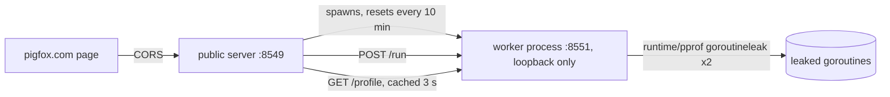

# leak-demo

[](https://github.com/pigfox/leak-demo/actions/workflows/ci.yml)
[](https://go.dev/doc/go1.27)
[](LICENSE)

**Real goroutine leaks, found live by Go 1.27's goroutine leak profile.**

[Live demo](https://pigfox.com/demos/goroutine-leaks) · [API](https://leaks.pigfox.com/api/scenarios) · [Go 1.27 release notes](https://go.dev/doc/go1.27) · [Go blog: goroutine leak profiles](https://go.dev/blog/goroutine-leak-profiles)

This is the backend of [pigfox.com/demos/goroutine-leaks](https://pigfox.com/demos/goroutine-leaks).
Visitors click a button, a real Go process starts leaking goroutines in one of five
classic ways, and the page shows two views side by side:

- the **goroutine dump** every Go version has had, where a leaked goroutine and a
  healthy idle one look exactly alike, and
- the **goroutine leak profile** (`pprof.Lookup("goroutineleak")`), which reports
  only goroutines that can never wake up, and the line each one is stuck on.

## The scenarios

| Scenario | The bug | The fix | Found by the leak profile? |
|---|---|---|---|
| Send with no receiver | a timed-out request's worker sends on an unbuffered channel nobody reads | buffer of one | yes |
| Forgotten `wg.Done()` | an early return skips `Done`, the waiter waits forever | `defer wg.Done()` | yes |
| Mutex never unlocked | an error path returns holding the lock | `defer mu.Unlock()` | yes |
| Select that can never fire | the caller leaves without reading or closing `done` | `defer close(done)` | yes |
| Context never cancelled | `cancel` is kept "for later" and never called | `defer cancel()` | yes |
| **The blind spot** | a goroutine waits on a channel still reachable from a global | (none) | **no**, and that's the honest limit |

Every scenario lives in [`internal/scenarios/scenarios.go`](internal/scenarios/scenarios.go)
between `demo:begin` and `demo:end` markers; the page shows exactly that code.

## How it works



- **Leaks need a disposable process.** A leaked goroutine never ends, so the only
  way to give its memory back is to end the process. The leaks live in a child
  worker, and the server replaces it every 10 minutes (or when it dies).
- **Two passes.** One leak-detecting GC pass can miss a goroutine whose
  primitive was still marked earlier in the cycle; the second catches it. The
  page shows both numbers.
- **Safe in public.** At most 2,000 leaks per worker lifetime, 20 runs a minute
  per IP, the profile cached for 3 seconds (each read runs a GC), loopback-only
  worker, and `/debug/pprof` never exposed.

## API

```
GET  /api/scenarios   bugs, fixes and code snippets (static, cached 5 min)
GET  /api/state       {"status": {...}, "profile": {"leaks": ..., "dump": ...}}
POST /api/run         {"scenario": "send", "variant": "leaky" | "fixed"}
```

```console
$ curl -s https://leaks.pigfox.com/api/state | jq '.profile.leaks.total'
```

## Run it

Requires Go 1.27 or later.

```console
$ go test -race ./...
$ go run ./cmd/leak-demo          # serves on :8549
$ curl -s -X POST localhost:8549/api/run -d '{"scenario":"mutex","variant":"leaky"}'
$ curl -s localhost:8549/api/state | jq '.profile.leaks.groups'
```

The tests run each scenario in-process and assert what Go's own leak profile
reports: every leaky version found, no fixed version, and not the blind spot.

## Deploy

```console
$ VERSION=$(git rev-parse HEAD) CREATED_AT=$(date -u +%FT%TZ) docker compose up -d --build
```

The container is read-only, non-root, capped at 160 MB and half a CPU.

## License

[MIT](LICENSE)
